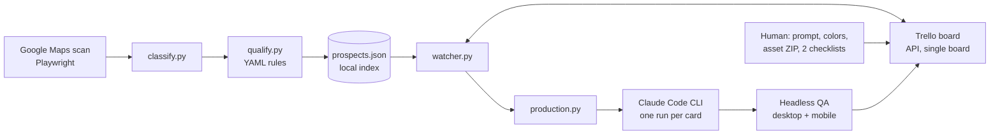

# Ecosys: prospecting and landing page pipeline

[](https://github.com/lksuey/ecosys/actions/workflows/tests.yml)

A Python pipeline that finds local businesses without a real website, qualifies them with explicit rules, tracks each one as a Trello card, and, once a human has prepared the inputs, runs Claude Code to build an individual landing page for that business.

The code, configuration and internal documents are written in Portuguese because that is the working language of the project. This README is the English entry point.

## The problem

Finding small businesses that only have a social profile or a chat number is slow manual work, and so is keeping the funnel organised. Building a page for each one is the expensive part. The goal was to automate the mechanical steps (discovery, filtering, card bookkeeping, running the generator, basic QA) while keeping judgement calls with a person.

## Engineering decisions

- **Rules over models for qualification.** Link classification (no site, WhatsApp only, social profile, link aggregator, parked or dead domain) and the qualification cut are plain YAML rules in `prospector/config/`, so every discard is explainable and editable.
- **Trello is the control panel, a local JSON file is the index.** The Maps place ID is mapped to the card ID in `prospector/data/prospects.json` (local, gitignored, written atomically under a lock). A card that disappears is never recreated automatically.
- **The Trello client is scoped to one board.** Every write checks that the target belongs to the configured board.
- **One non-interactive Claude Code run per card**, restricted to file read and edit tools, fingerprinted on the card description and attached ZIPs so unchanged inputs never trigger a second run.
- **Admission control.** At most five cards are admitted per cycle and 40 are kept in the active lists; the scanner works in batches of up to five combinations and saves a cursor only after a full batch.
- **Local QA after generation.** A headless browser checks title, `h1`, viewport, local files, anchors, broken images, JS errors and horizontal scroll at desktop and mobile sizes, and stores screenshots.

## Architecture



## Layout

| Path | Purpose |
| --- | --- |
| `prospector/` | Scanner, classifier, qualifier, store, Trello client, watcher, production runner, CLI |
| `prospector/config/` | Verticals, neighbourhoods, exclusions and link rules, Trello board spec (`trello.example.yaml` shows the generated file) |
| `tests/` | Unit tests with fakes for Trello and Claude; no real services |
| `examples/prospects.sample.json` | Synthetic prospects showing the index format |
| `docs/`, `playbook-LP.md` | Architecture and operating rules (Portuguese) |
| `scripts/scan_sensitive.py` | Pre-publication scan for secrets and personal data |

## How to run

Requirements: Python 3.11+, Chromium or Chrome for Playwright, and (for production only) the Claude Code CLI installed and authenticated.

```powershell
python -m venv .venv
.venv\Scripts\python -m pip install -r prospector/requirements.txt
.venv\Scripts\python -m playwright install chromium
.venv\Scripts\python -m prospector.cli check          # validates configuration
.venv\Scripts\python -m unittest discover tests       # offline tests
```

To use it for real, create `prospector/.secrets/trello.json` from `prospector/.secrets.example.json`, then run `python -m prospector.cli trello setup`. Credentials, the Chrome profile, the local index, run logs and generated sites are gitignored by design. Collection must respect the terms of the sources you scan.

## Limitations

- The decision about inputs (prompt, colors, which photos), visual review, publishing and commercial contact stay human. The pipeline never publishes a site or contacts a business.
- Capacity limits (cards per cycle, active cards) are throttles for the operator and the model quota. They say nothing about sales volume or conversion.
- The full flow with Claude Code was not validated end to end in this repository; tests replace Trello and Claude with fakes.
- The scanner depends on the current Google Maps page structure and will need maintenance when it changes.
- Business-specific choices (city, neighbourhoods, verticals) are configured for one Brazilian city.

Built with AI assistance; design, domain rules and review by the author.
